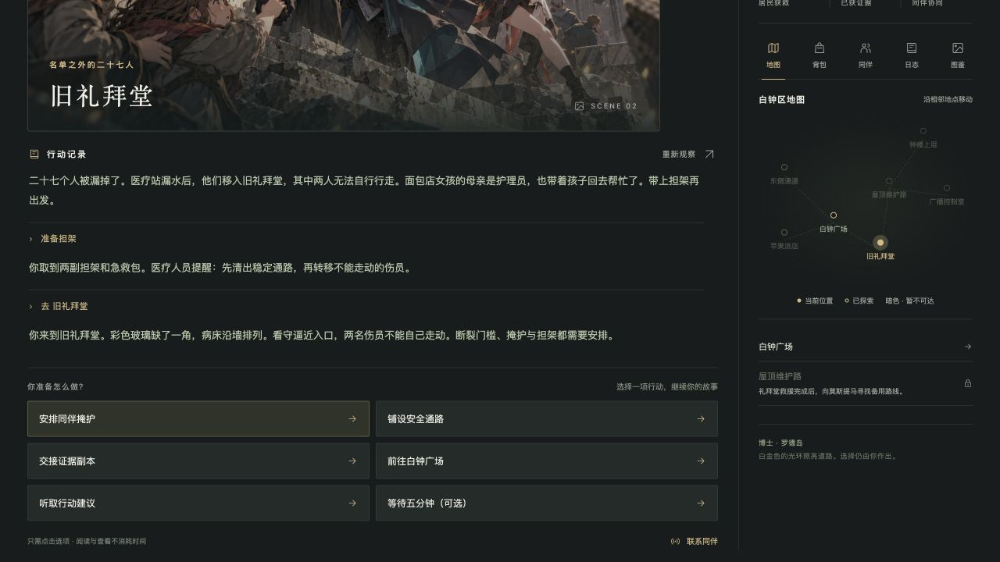

# 第十三声钟响

一款发生在拉特兰的单人文字冒险。扮演博士，追查伪造的命令、营救礼拜堂居民，与同伴一起阻止钟楼中的危机。

[直接在线游玩](https://violetloveAI.github.io/thirteenth-bell-mud/)

## 怎么玩

点击“开始行动”，阅读场景与行动记录，再选择行动或地图上的可达地点。整个流程只需点击选项，无需输入命令；没有思路时，可以听取行动建议。

- 三张 CG 随故事解锁，可在图鉴中放大查看。
- 救援、证据保全、同伴分工和行动时间会影响三种结局。
- 进度自动保存在当前浏览器；设置中可导出或导入 JSON 存档。
- 提供背景与操作引导、逐字显示及可关闭的音效。
- 时间随行动推进，阅读、查看和获取提示不消耗时间。

清除浏览器数据可能导致自动存档丢失。换设备前，请先导出存档。

## 本地运行

需要 Python 3。在仓库目录运行 `python3 -m http.server 4178 --bind 127.0.0.1`，再打开 [本地游戏页面](http://127.0.0.1:4178/)。游玩结束后按 `Ctrl+C` 停止服务。多文件版本使用浏览器 ES 模块，请通过 HTTP 服务打开。

## 实现

使用 HTML、CSS 和原生 JavaScript，无第三方运行时依赖、服务端或 AI API 调用。`index.html` 是入口，`app.mjs` 负责界面与存档，`engine.mjs` 负责游戏规则，`style.css` 负责样式，场景图位于 `assets/`。

使用 Node.js 可运行 `node --test tests/engine.test.mjs` 检查游戏规则与三条结局路线。

## 作品说明

作者：violet。本项目是基于《明日方舟》世界观的非官方同人作品，采用独立故事与部分自设，与游戏官方无关联。
